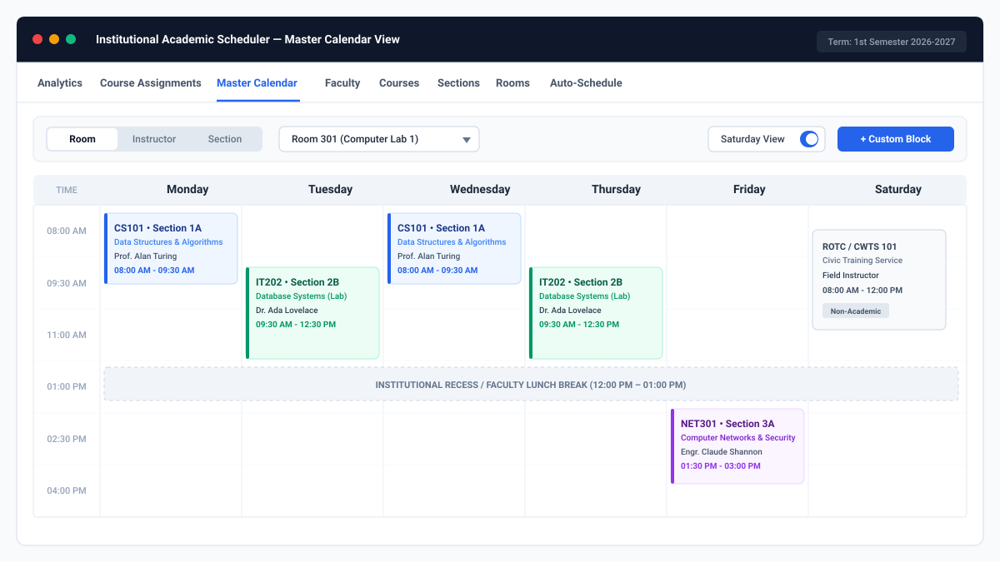
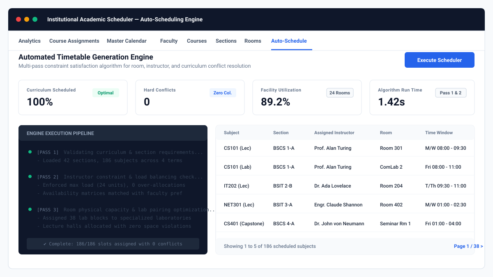
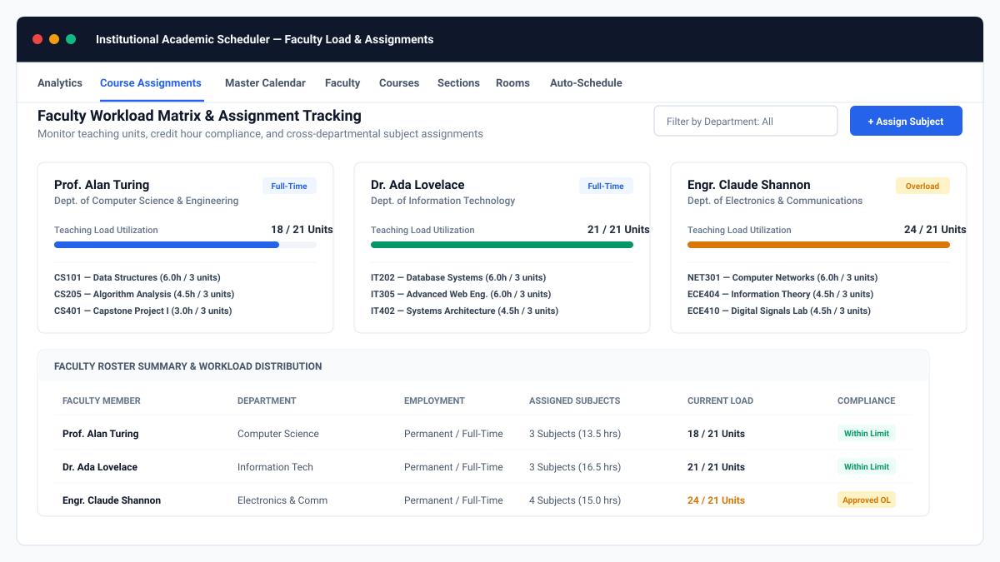
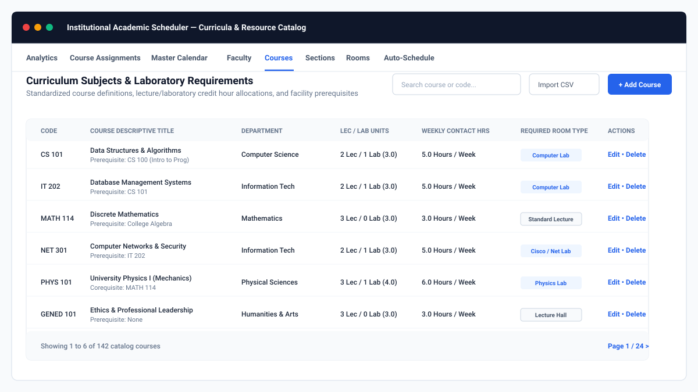

# College Scheduler System

An enterprise-grade academic timetable automation and schedule management platform designed for higher education institutions. The system features a multi-pass constraint-satisfaction auto-scheduling engine, an interactive multi-perspective timetable calendar, faculty workload compliance monitoring, and centralized curriculum and facility inventory management.

[](https://nextjs.org/)
[](https://react.dev/)
[](https://tailwindcss.com/)
[](https://www.djangoproject.com/)
[](https://www.django-rest-framework.org/)
[](https://www.python.org/)

---

## System Feature Snapshots

### 1. Master Timetable & Synchronized Multi-View Calendar
A synchronized scheduling interface supporting three administrative perspectives: Room Utilization, Faculty Schedule, and Student Cohort Section. Features drag-and-drop slot rescheduling, Saturday session support, real-time collision detection, and customizable institutional non-academic blocks (e.g., campus recess, department assemblies, office hours).



---

### 2. Automated Timetable Generation Engine
Heuristic constraint-satisfaction scheduling engine that automates timetable creation across entire academic terms. Automatically balances hard constraints (facility double-booking, faculty availability, section overlaps) with soft preferences and includes an automated fallback relaxation pass to achieve 100% curriculum allocation.



---

### 3. Faculty Workload & Assignment Matrix
Real-time tracking of instructor teaching units, weekly contact hours, and employment classification (full-time vs. part-time). Built-in compliance checks prevent over-allocation and surface institutional overload indicators.



---

### 4. Curricula, Section Cohorts & Facility Inventory
Centralized management for departments, academic terms, courses, student sections, and classroom/laboratory facilities. Differentiates lecture versus laboratory unit requirements and pairs courses with specialized room requirements (computer labs, engineering shops, science laboratories, lecture halls).



---

## Core Capabilities

- **Intelligent Conflict Prevention:** Real-time visual and algorithmic validation prevents overlapping room bookings, instructor time conflicts, and section collisions.
- **Three-Dimensional Scheduling Perspective:** Seamlessly pivot the entire schedule view between Classroom Facilities, Instructors, and Student Sections.
- **Curricular Breakdown Support:** Independent tracking and allocation of lecture hours versus laboratory contact hours per course.
- **Faculty Load Safeguards:** Automated calculation of teaching units against maximum institutional limits, providing automated alerts when limits are approached or exceeded.
- **Institutional Recess & Custom Blocks:** Configurable administrative time blocks (e.g., University Lunch Hour, Faculty Senate Meetings, Advising) with configurable credit load tracking.
- **Saturday Scheduling:** Independent toggle to enable or disable weekend courses and non-academic activities (e.g., NSTP, ROTC, graduate school offerings).
- **Import / Export Capabilities:** Batch CSV catalog ingestion and formatted timetable export options.

---

## System Architecture

```
[ Academic Administration Client (Next.js 16 / React 19) ]
                         |
                 HTTP / RESTful API
                         |
[ Django 5.x REST Backend Core ]
  ├── ViewSets & Routers (Departments, Rooms, Courses, Terms, Sections)
  ├── Workload Verification Services
  └── Timetable Engine
        ├── Pass 1: Hard Constraints (Double-booking, overlaps, room capacities)
        ├── Pass 2: Faculty Load Distribution (Unit quotas, preference matrices)
        ├── Pass 3: Facility Specialization (Computer labs, specialized equipment)
        └── Pass 4: Fallback Relaxation (Unassigned queue resolution)
                         |
             [ Relational Database (SQLite / PostgreSQL) ]
```

---

## Technology Stack

| Layer | Technology | Function |
| :--- | :--- | :--- |
| **Frontend Framework** | Next.js 16 (App Router), React 19 | High-performance institutional administrative interface |
| **Language** | TypeScript, Python | Full-stack static typing and robust backend computation |
| **Styling & Design System** | Tailwind CSS v4, Headless UI | Clean, institutional design system with restrained typography |
| **Calendar Engine** | React Big Calendar, Moment.js | Interactive drag-and-drop timetable management |
| **Backend Framework** | Django 5.x, Django REST Framework | Domain logic, data serialization, and RESTful API endpoints |
| **Constraint Solver** | Custom Python Engine | Multi-pass heuristic timetable generation algorithm |
| **Database** | SQLite (Development) / PostgreSQL (Production) | Relational integrity and schedule persistence |

---

## Getting Started

### Prerequisites
- Node.js (v18.0.0 or higher)
- Python (v3.10 or higher)
- npm or yarn

---

### Quick Launch (Windows)
For local development on Windows systems, execute the included batch script to start both backend and frontend servers simultaneously:

```cmd
Start_Scheduler.bat
```

---

### Manual Setup

#### 1. Backend Service
```bash
# Navigate to the backend directory
cd backend

# Create and activate a virtual environment
# Windows:
python -m venv venv
venv\Scripts\activate

# Linux / macOS:
python3 -m venv venv
source venv/bin/activate

# Install required packages
pip install -r requirements.txt

# Run database schema migrations
python manage.py migrate

# Start the Django API server
python manage.py runserver
```
The backend API service will be accessible at `http://127.0.0.1:8000/`.

#### 2. Frontend Client
```bash
# Navigate to the frontend directory
cd frontend

# Install client dependencies
npm install

# Start Next.js in development mode
npm run dev
```
The web application will be accessible at `http://localhost:3000/`.

---

## Primary API Endpoints

| Endpoint | Method | Description |
| :--- | :--- | :--- |
| `/api/dashboard-data/` | `GET` | Aggregated payload for instructors, rooms, courses, sections, and schedules |
| `/api/auto-schedule/` | `POST` | Triggers the automated timetable generation engine for a selected term |
| `/api/schedule-slots/` | `GET`, `POST` | Lists and creates individual schedule slots on the master calendar |
| `/api/schedule-slots/{id}/` | `PUT`, `DELETE` | Updates time slots, room assignments, or removes timetable entries |
| `/api/courses/` | `GET`, `POST` | Manages academic course catalog, credit units, and lab requirements |
| `/api/instructors/` | `GET`, `POST` | Manages instructor rosters, employment status, and max load limits |
| `/api/rooms/` | `GET`, `POST` | Manages room directory, physical seat capacities, and room types |
| `/api/sections/` | `GET`, `POST` | Manages academic student cohorts and program tracks |
| `/api/departments/` | `GET`, `POST` | Manages institutional department structures |
| `/api/terms/` | `GET`, `POST` | Manages academic years and terms/semesters |

---

## Design Principles

This application adheres to an institutional design standard:
- **Restrained Typography:** Clear hierarchy prioritizing information legibility over decorative styling.
- **Functional Iconography:** Minimal icon usage restricted strictly to functional actions (edit, delete, search, close) to avoid visual clutter.
- **Institutional Color Palette:** Slate foundation with crisp borders and subtle accents to maintain an executive university portal aesthetic.
- **Data Density:** High-utility tables and grids formatted for registrar and academic scheduler operations.

---

## Author & Project Information

- **Developer:** Ar-jay F. Llanera
- **Repository:** College Scheduler System
- **License:** Proprietary - All Rights Reserved
